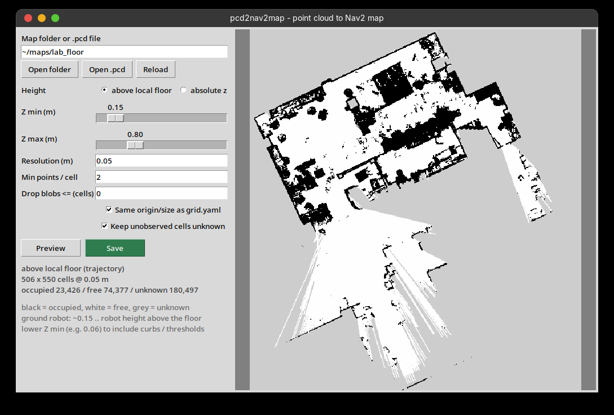
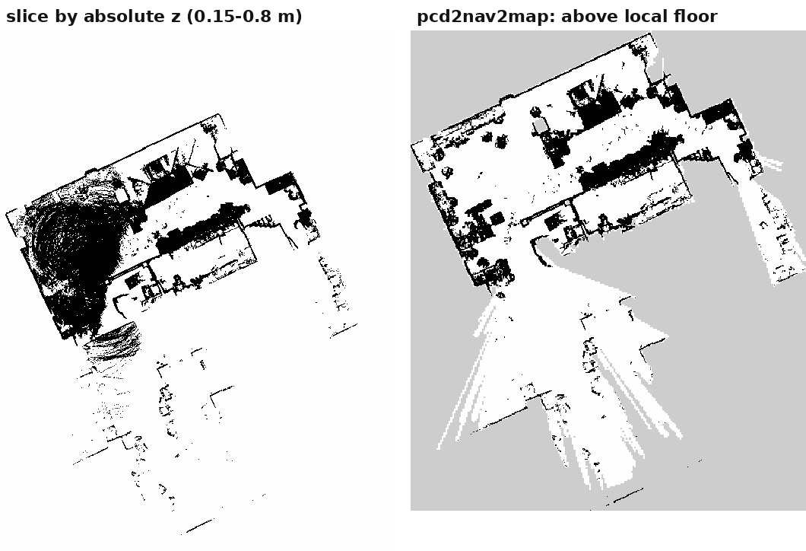
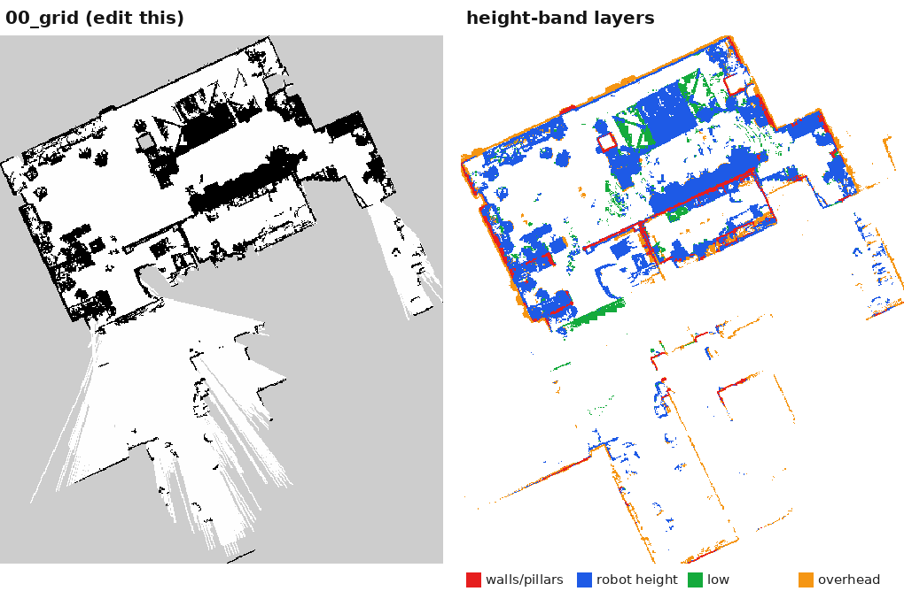

# pcd2nav2map

**Turn a 3D LiDAR point cloud map (`.pcd`) into a Nav2 2D occupancy map (`.pgm` + `.yaml`) — with a live-preview GUI,
heights measured above the *local floor*, and a GIMP layer workflow for hand-editing the final map.**

Pure Python (NumPy / SciPy / Pillow / Tkinter). No ROS, PCL or Open3D needed — run it on your laptop, copy the map to
the robot. Works with maps from FAST-LIO2, LIO-SAM, KISS-ICP, or any SLAM that saves a PCD.



## Why another PCD → map converter?

The usual recipe is "keep the points between z = a and z = b, mark every cell that has some". It breaks in three
common ways — this tool fixes each:

| Problem with a plain z-slice | pcd2nav2map |
|---|---|
| The map is slightly **tilted** (IMU start-up, a long ramp, two merged sessions), so one side of the floor rises into the slice and becomes a wall of fake obstacles | Heights are measured **above the local floor**, estimated per 0.2 m cell from the robot trajectory (or from the cloud itself) |
| Every cell without points is **free**, including places the robot never saw — a planner will happily route through them | Cells your existing map marks **unknown** stay unknown |
| The output has its own origin/size every time, so it can't be layered over the map you already have | Optionally reuses **the origin and size of an existing `grid.yaml`**, pixel for pixel |
| Python loops over millions of points | Vectorised: **5 M points in ~1.5 s** |


*The same map (1.9° tilt from a bad IMU start-up). Left: a fixed z band turns the rising floor into obstacles.
Right: floor-relative heights; grey = never observed.*

## Install

```bash
sudo apt install python3-tk            # Tkinter, if your Python doesn't have it
pip install git+https://github.com/lkh0320/pcd2nav2map.git
```

## Usage

### GUI

```bash
pcd2nav2map                     # pick a folder / .pcd in the window
pcd2nav2map ~/maps/lab_floor    # folder with map.pcd (+ poses.txt) (+ grid.yaml)
pcd2nav2map ~/maps/cloud.pcd    # or just a point cloud
```

Move the **Z min / Z max** sliders, press **Preview**, then **Save** (`grid_points.pgm` + `.yaml`, ready for
`nav2_map_server`).

- *Ground robot:* about `0.15 m … robot height + margin` above the floor.
- Lower **Z min** to ~`0.06 m` to also block curbs, door thresholds and low platforms the robot can't climb.
- **Min points / cell** filters sparse noise; **Drop blobs** removes isolated specks of up to N cells.

### Batch

```bash
pcd2nav2map ~/maps/lab_floor --no-gui --zmin 0.15 --zmax 0.8 --res 0.05 --out ~/maps/lab_floor/grid.pgm
```

| Option | Default | |
|---|---|---|
| `--zmin`, `--zmax` | 0.15, 0.8 | height band (m) |
| `--res` | 0.05 | cell size (m) |
| `--min-points` | 2 | points per cell to mark it occupied |
| `--absolute` | off | use raw map z instead of height above the floor |
| `--poses FILE` | `<folder>/poses.txt` | trajectory for the floor estimate |
| `--no-align` | off | don't reuse `grid.yaml`'s origin and size |
| `--no-unknown` | off | every cell without points is free |
| `--despeckle N` | 0 | drop occupied blobs of at most N cells |

### Hand-editing in GIMP

Automatic maps are never perfect: a chair that was there during mapping, a box that will be moved, a glass wall the
LiDAR can't see. The fastest fix is often a human with a brush. `pcd2nav2map-layers` exports the point cloud as
**height-band layers that line up pixel for pixel with your map**, so you can see *what* each black blob is while you
edit.

```bash
pcd2nav2map-layers export ~/maps/lab_floor
#  -> ~/maps/lab_floor/grid_edit/00_grid.png, 10_walls_pillars.png, 20_robot_height.png, 30_low.png,
#     40_overhead.png, 50_height.png
```



1. GIMP → **File → Open as Layers…** → select all the PNGs.
2. Edit `00_grid`: paint movable things white, add missing walls in black, leave grey (unknown) alone.
   The colour layers tell you what is what — red: walls/pillars (floor to 1.5 m+, almost certainly fixed),
   blue: robot-height objects (desks, chairs, boxes), green: low (thresholds, platforms), orange: overhead.
3. Hide the colour layers, **File → Export As** `grid_static.png` (don't change the canvas size).
4. Import:

```bash
pcd2nav2map-layers import ~/maps/lab_floor ~/maps/lab_floor/grid_edit/grid_static.png
```

Dark pixels (< 100) become occupied, very light (> 230) free, everything else unknown. The previous map is kept as
`grid_auto.pgm`; `grid.yaml` is unchanged, so localization and the planner keep working.

A common workflow for missions with **random obstacles**: map a clean environment, keep only the truly static
structure (walls, pillars, fixed desks) in the global map, and let Nav2's costmap (e.g. with the MPPI controller)
handle whatever appears at run time.

## Input

| File | Needed | |
|---|---|---|
| `map.pcd` | yes | ascii, binary or binary_compressed; only x y z are used |
| `poses.txt` | no | trajectory for the floor estimate: FAST-LIO2 PGO (`name x y z qw qx qy qz`), TUM (`t x y z qx qy qz qw`) or `x y z ...` per line |
| `grid.yaml` + image | no | existing Nav2 map: reused for origin/size and unknown cells |

**Local floor.** With a trajectory (a ground robot with a ground-level body frame), the floor of each 0.2 m cell is the
10th percentile of the points near the nearest pose's height, followed by a 3×3 minimum. Without one, the 10th
percentile of each 0.4 m column is used, median-smoothed — fine as long as the floor is visible in the cloud.

## Tests

```bash
python3 -m pytest tests -q
```

Synthetic tilted room (walls, a box, a low step, an overhead shelf), all PCD encodings, the GIMP round trip.

## Limitations

- Occupancy comes from point counts only (no ray casting): a dynamic object captured in the cloud stays an obstacle.
  Clean the cloud first (e.g. [lidar_map_cleaner](https://github.com/lkh0320/lidar_map_cleaner)) or paint it out in GIMP.
- Single floor level per (x, y). Multi-storey or bridge-over-floor maps need a cropped cloud per level.
- `binary_compressed` PCDs are decompressed in pure Python (a few seconds per million points).

## Credits

Started from a small z-slice converter script shared by a lab senior; rebuilt for floor-relative heights, unknown
cells, alignment and the GIMP workflow.

## License

MIT
